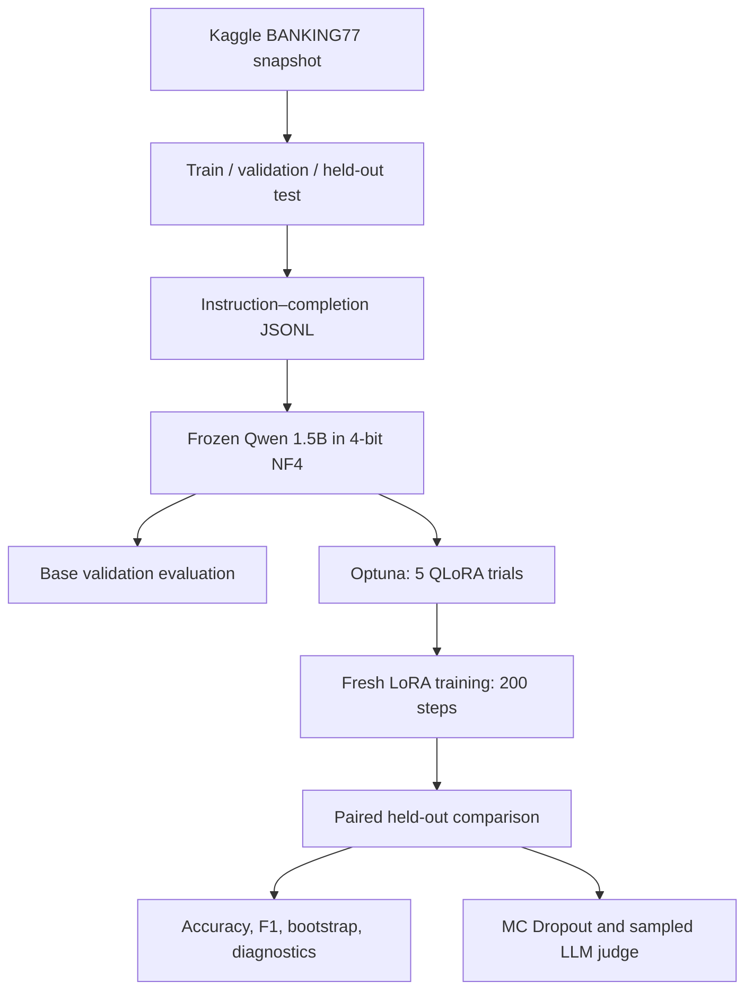

# BankingIntent-QLoRA

**Fine-tuning Qwen2.5-1.5B-Instruct for 77-way banking intent classification with QLoRA and Optuna.**

This repository documents a reproducible Google Colab experiment that trains a fresh LoRA adapter, compares it with the untouched base model on the same held-out BANKING77 examples, and evaluates classification performance, statistical uncertainty, and inference behavior.

> **Main result:** Held-out accuracy increased from **39.51% to 73.18%** (**+33.67 percentage points**; paired bootstrap 95% CI **[+31.75, +35.62] points**) after 200 optimizer steps. This is an experimental result, not a production performance claim.

## Results

| Metric | Untouched base | QLoRA fine-tuned |
| --- | ---: | ---: |
| Test accuracy | 39.51% | **73.18%** |
| Macro-F1 | 0.3692 | **0.7262** |
| Macro precision | 0.5323 | **0.7609** |
| Invalid-label rate | 5.78% | **0.45%** |
| Validation cross-entropy | 1.132751 | **0.276002** |
| Mean single-example generation latency | 0.260 s | 0.461 s |

Test set: 3,080 examples. The label metrics use whitespace normalization and case-insensitive matching. Invalid predictions count as incorrect. The latency numbers are measured from sequential generation on one NVIDIA L4 and are not a throughput benchmark.

### Paired error analysis

| Comparison on the same test example | Count |
| --- | ---: |
| Fine-tuned correct, base incorrect | 1,167 |
| Base correct, fine-tuned incorrect | 130 |
| Both have the same correctness status | 1,783 |

The paired bootstrap used 10,000 resamples of test *examples*, preserving the base/fine-tuned pair in each resample. The accuracy difference was **+0.3367**, with percentile 95% CI **[+0.3175, +0.3562]**. Its interval excludes zero under the resampling assumptions.

## Method



### Dataset

- [Kaggle: BANKING77 Reproducibility Snapshot](https://www.kaggle.com/datasets/ahtashamulhaque/banking77-reproducibility-snapshot)
- Original benchmark: [PolyAI BANKING77](https://github.com/PolyAI-LDN/task-specific-datasets), Casanueva et al. (2020).
- English-language customer queries labeled with one of **77 fine-grained banking intents**.
- Prepared dataset: **8,495 train / 1,501 validation / 3,080 held-out test**.
- The original test split was retained. Seven distinct exact train–test prompt overlaps were detected; overlapping training rows were removed. This only guards against exact normalized duplicates, not semantic near-duplicates.
- Each training record has `prompt`, `completion`, and `group_id`; test records include `id`, `prompt`, `reference`, `label`, `eval_type`, and `group_id`.

The prepared JSONL files reside in Google Drive in the experiment workflow; the raw dataset is downloaded from Kaggle. Do not mix the held-out test data into hyperparameter selection.

### Model and training

| Component | Configuration |
| --- | --- |
| Base model | [Qwen/Qwen2.5-1.5B-Instruct](https://huggingface.co/Qwen/Qwen2.5-1.5B-Instruct) |
| Hardware | Google Colab, NVIDIA L4 |
| Quantization | 4-bit NF4, double quantization, BF16 compute |
| Adaptation | LoRA on all linear layers; frozen base weights |
| Trainable parameters | 18,464,768 (about 1.182% of 1,562,179,072 reported parameters) |
| Batch / accumulation | 1 / 4 (effective batch 4) |
| Max sequence length | 1,024 tokens |
| Final training | 200 optimizer steps; fresh adapter |
| Optimization | Optuna TPE, 5 trials; minimize validation loss |

**Selected Optuna parameters (trial 3):**

```json
{
  "lora_r": 16,
  "alpha_multiplier": 2,
  "lora_dropout": 0.05,
  "learning_rate": 0.00021783403357582184,
  "weight_decay": 0.0,
  "warmup_ratio": 0.05,
  "scheduler": "cosine"
}
```

The best Optuna trial had validation loss **0.240760**. A separately initialized and trained final adapter produced validation loss **0.276002**. The two numbers are not identical and should not be conflated.

## Additional evaluation

- **Per-class analysis:** The largest gains included `verify_top_up` (F1 0.000 → 0.975), `card_about_to_expire` (0.000 → 0.861), and `pin_blocked` (0.049 → 0.805). `card_arrival` remained difficult (fine-tuned F1 0.448).
- **Monte Carlo Dropout:** 30 passes over one validation example using the existing adapter's 0.05 dropout. Reference-token predictive entropy was 0.150131 and estimated mutual information 0.000253. These are exploratory token-level uncertainty diagnostics, not calibrated probabilities of correct intent classification.
- **LLM-as-a-Judge:** An independent [Mistral-7B-Instruct-v0.3](https://huggingface.co/mistralai/Mistral-7B-Instruct-v0.3) judged a stratified selection of two test examples per class. **130/154** evaluations produced valid structured outputs; **24 failed** JSON validation and were excluded. On the 130 valid cases, the judge preferred fine-tuned **53**, base **13**, and tied **64**. Mean overall scores were **4.567/5** and **3.789/5**, respectively. Judge responses are supplementary and potentially biased; exact-label ground truth metrics remain primary.

## Reproduce in Colab

1. Open `notebooks/BankingIntent_QLoRA_Optuna_Evaluation.ipynb` in [Google Colab](https://colab.research.google.com/) after adding the notebook to this repository.
2. Select a CUDA GPU runtime (tested on NVIDIA L4). Run the dependency-install cell, then restart the runtime if Colab requests it.
3. Connect Google Drive and download the Kaggle snapshot with `kagglehub`, using dataset ID `ahtashamulhaque/banking77-reproducibility-snapshot`.
4. Prepare `train.jsonl`, `validation.jsonl`, and `test.jsonl` in `MyDrive/QLoRA_Data`. Confirm exact-prompt split isolation.
5. Execute the notebook in order: frozen-base evaluation → Optuna search → **fresh** QLoRA training → held-out generation → classification and uncertainty analyses → final report.
6. Use the final inference cell to reload the saved PEFT adapter. A separate top-3 analysis scores all 77 allowed label sequences and normalizes their log-likelihoods; these relative scores are **not calibrated confidence estimates**.

The training stack used in the reported run was PyTorch **2.14.1+cu130**, Transformers **5.23.0**, PEFT **0.21.3**, and TRL **1.18.1**. Other Colab images or dependency versions may require compatibility adjustments.

### Example inference

```text
Customer: I lost my debit card yesterday. What should I do?
Predicted intent: lost_or_stolen_card

Customer: How can I change my card PIN?
Predicted intent: change_pin

Customer: I want to close my bank account.
Predicted intent: terminate_account
```

Ambiguous transfer queries can receive a high relative score for an arguably incorrect label. For example, `My bank transfer hasn't arrived yet.` yielded `balance_not_updated_after_bank_transfer` with 95.88% of the normalized 77-label candidate mass. That figure is **not** a calibrated correctness probability.

## Expected repository layout

```text
BankingIntent-QLoRA/
├── README.md
├── notebooks/
│   └── BankingIntent_QLoRA_Optuna_Evaluation.ipynb
├── results/
│   ├── classification_results.csv
│   ├── optuna_results.csv
│   └── final_evaluation_report.json
└── assets/
    ├── confusion_matrix.png
    ├── f1_improvements.png
    └── top3_intents.png
```

The notebook, result exports, and plots must be copied from the completed Colab run before their paths above become live repository files. Do **not** commit model checkpoints, private credentials, Kaggle authentication files, or the raw dataset. The PEFT adapter can be distributed separately where licenses and hosting permissions allow.

## Limitations

This is a single-model, single-dataset experiment with one final training seed and 200 steps (less than one full pass over the prepared training set). Five Optuna trials do not establish globally optimal settings. The benchmark is English-only and does not test out-of-domain banking requests, security, drift, or real customer workflows. Exact duplicate filtering does not detect all leakage. The LLM judge has missing outputs and possible evaluator bias; the MC Dropout diagnostic covers only one validation example. No deployment or production-safety claims are made.
